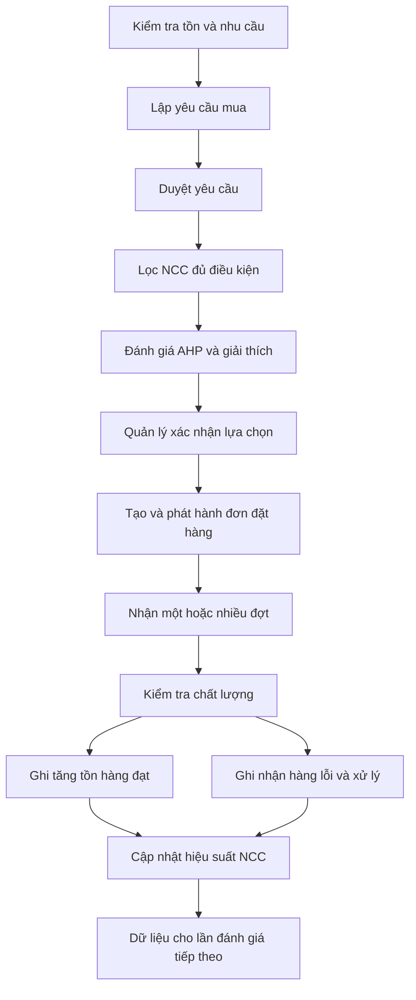

# ĐỀ XUẤT NÂNG CẤP ĐỀ TÀI

## Xây dựng hệ thống quản lý nhập hàng và lựa chọn nhà cung cấp bằng AHP

**Phiên bản:** 1.1 — ngày 07/10/2026  
**Mục đích:** Làm kế hoạch thiết kế, triển khai, kiểm chứng và chuẩn bị bảo vệ đề tài do người thực hiện phối hợp với GPT/Codex thực hiện.  
**Trạng thái:** Đề xuất thiết kế; chức năng và kết quả minh họa chưa phải kết quả đã triển khai. Tiến độ được cập nhật theo mã nguồn hiện có và thời hạn nộp thực tế.

### Cách tổ chức thực hiện

Đề tài do một người thực hiện với sự hỗ trợ của GPT/Codex, không có người hướng dẫn triển khai. Các bước thiết kế và lập trình không phụ thuộc vào việc chờ một người hướng dẫn duyệt.

- **Người thực hiện:** Xác định mục tiêu, cung cấp yêu cầu và thời hạn, lựa chọn các phương án có ảnh hưởng đến phạm vi, chạy thử ứng dụng và nắm được cách giải thích khi bảo vệ.
- **GPT/Codex:** Phân tích mã nguồn, đề xuất và giải thích phương án, hỗ trợ thiết kế, chỉnh sửa mã, kiểm tra lỗi, đối chiếu thuật toán và soạn tài liệu. Với các quyết định kỹ thuật thông thường trong phạm vi đã thống nhất, chủ động triển khai và báo lại kết quả.
- **Cách phối hợp:** Mỗi chặng tạo một kết quả có thể xem hoặc chạy thử. Các giả định và giới hạn được ghi rõ; chỉ hỏi thêm khi thiếu thông tin ảnh hưởng đáng kể đến kết quả.
- **Vai trò giảng viên:** Đánh giá đề tài và đưa ra yêu cầu hoặc nhận xét nếu có. Những yêu cầu này được cập nhật vào kế hoạch, không được xem là một bước hướng dẫn bắt buộc cho mỗi chặng triển khai.

Các vai trò quản lý, nhân viên mua hàng và nhân viên kho bên dưới là người dùng giả định của ứng dụng, không phải thành viên nhóm thực hiện đề tài.

---

## 1. Tóm tắt đề xuất

Đề tài xây dựng hệ thống quản lý hoạt động mua và nhập hàng cho một doanh nghiệp nhỏ có nhiều nhà cung cấp. Hệ thống hỗ trợ toàn bộ quá trình từ phát hiện nhu cầu mua, lập yêu cầu, đánh giá và lựa chọn nhà cung cấp, đặt hàng, nhận hàng, kiểm tra chất lượng đến cập nhật dữ liệu hiệu suất nhà cung cấp.

Phương pháp AHP được sử dụng để xác định mức độ ưu tiên của các tiêu chí và hỗ trợ lựa chọn nhà cung cấp tại thời điểm lập kế hoạch mua. Kết quả đánh giá được trình bày cùng dữ liệu đầu vào, mức đóng góp của từng tiêu chí và phân tích độ nhạy. Sau mỗi lần nhận hàng, dữ liệu thực tế được tích lũy để phục vụ những lần đánh giá tiếp theo.

Giá trị của đề tài nằm ở sự kết nối giữa **quy trình nghiệp vụ, dữ liệu giao dịch và hỗ trợ quyết định đa tiêu chí**. Độ sâu được thể hiện bằng việc xử lý trạng thái, nhận hàng nhiều đợt, chất lượng hàng nhập, dữ liệu thiếu, phiên bản đánh giá và khả năng giải thích kết quả.

**Phạm vi được chọn:** Hệ thống nội bộ của một doanh nghiệp, một kho; có thể đặt trong bối cảnh cửa hàng bán trực tuyến. Sàn B2B, gian hàng, phí quảng cáo và trợ lý AI là những hướng mở rộng riêng, không nằm trong bản đề xuất này.

## 2. Vấn đề và câu hỏi cần giải quyết

### 2.1. Vấn đề nghiệp vụ

Một sản phẩm có thể được cung cấp bởi nhiều nhà cung cấp với giá, chất lượng, khả năng giao hàng và điều kiện thanh toán khác nhau. Chọn nhà cung cấp chỉ theo giá thấp có thể làm tăng rủi ro giao trễ, giao thiếu hoặc hàng lỗi. Đánh giá dựa trên kinh nghiệm cá nhân cũng khó giải thích và khó đối chiếu giữa các lần mua.

Nếu phần mềm chỉ lưu phiếu nhập và có một màn hình tính AHP độc lập, kết quả đánh giá chưa gắn chặt với quyết định mua hàng và chưa tận dụng được dữ liệu phát sinh trong hệ thống.

### 2.2. Câu hỏi nghiên cứu và thiết kế

1. Làm thế nào tích hợp việc đánh giá nhà cung cấp vào quy trình mua hàng?
2. Làm thế nào kết hợp ưu tiên của người quản lý với dữ liệu lịch sử và báo giá hiện tại?
3. Kết quả lựa chọn thay đổi như thế nào khi mức độ ưu tiên của các tiêu chí thay đổi?
4. Làm thế nào lưu lại căn cứ lựa chọn để giải thích và tái hiện một quyết định đã đưa ra?

### 2.3. Mục tiêu cụ thể

- Quản lý nhất quán yêu cầu mua, đơn đặt hàng, nhận hàng và kiểm tra chất lượng.
- Hỗ trợ lựa chọn nhà cung cấp theo từng sản phẩm và tình huống mua.
- Kiểm tra tính nhất quán của đánh giá so sánh cặp.
- Giải thích điểm tổng hợp bằng mức đóng góp của từng tiêu chí.
- Phân tích mức ổn định của lựa chọn khi thay đổi trọng số.
- Lưu dữ liệu và phiên bản mô hình tại thời điểm quyết định.
- Đánh giá hệ thống bằng bộ dữ liệu mẫu, đối chiếu thuật toán và các tình huống nghiệp vụ.

Không cam kết rằng hệ thống luôn chọn được nhà cung cấp tốt nhất ngoài thực tế hoặc chắc chắn giảm chi phí. Các kết luận về hiệu quả phải dựa trên dữ liệu và thực nghiệm phù hợp.

## 3. Bối cảnh và giả định

Chọn một doanh nghiệp kinh doanh phụ kiện điện tử, có khoảng 50–200 mã hàng và 10–30 nhà cung cấp. Một mã hàng có thể có 2–5 nhà cung cấp đủ điều kiện. Các con số này là quy mô dữ liệu minh họa, không phải kết quả khảo sát.

Các giả định ban đầu:

- Một doanh nghiệp, một kho, một đồng tiền sử dụng trong so sánh.
- Sản phẩm được quản lý theo mã và đơn vị chuẩn; chỉ so sánh hàng có quy cách tương đương.
- Mỗi đơn đặt hàng thuộc một nhà cung cấp; một yêu cầu mua có thể sinh nhiều đơn cho các nhà cung cấp khác nhau.
- Một dòng yêu cầu mua được giao cho một nhà cung cấp trong phiên bản đầu. Chia cùng một dòng cho nhiều nhà cung cấp là hướng mở rộng.
- Cho phép nhận một đơn đặt hàng qua nhiều đợt.
- Tồn kho có thể bán chỉ tăng khi hàng đã được xác nhận đạt chất lượng.
- Có phiếu xuất và điều chỉnh tồn đơn giản để phản ánh giảm tồn; chưa xây dựng hệ thống bán hàng.
- Cảnh báo tồn thấp đề xuất hành động, không tự động phát hành đơn mua.
- Quản lý có quyền chọn khác gợi ý nhưng phải lưu lý do.

Liên hệ TMĐT được thể hiện ở nhu cầu bổ sung hàng cho cửa hàng bán trực tuyến. Hệ thống phục vụ hoạt động mua hàng phía sau kênh bán; chưa tích hợp sàn hoặc quản lý đơn bán. Đối chiếu mức độ đáp ứng chuyên ngành với yêu cầu môn học và nhận xét đánh giá đã có; nếu chưa có tiêu chí cụ thể, ghi đây là giả định phạm vi để tiếp tục triển khai.

## 4. Phạm vi chức năng

| Nhóm | Chức năng | Mức ưu tiên |
|---|---|---|
| Dữ liệu nền | Sản phẩm, danh mục, nhà cung cấp, sản phẩm được cung cấp, đơn vị và giá tham khảo | Cốt lõi |
| Nhu cầu mua | Cảnh báo tồn thấp, yêu cầu mua, duyệt hoặc từ chối | Cốt lõi |
| Lựa chọn NCC | Lọc điều kiện, so sánh cặp, CR, trọng số, điểm và xếp hạng | Cốt lõi |
| Đặt hàng | Tạo đơn từ yêu cầu đã duyệt, lưu căn cứ chọn và lý do chọn khác | Cốt lõi |
| Nhận hàng | Giao từng phần, kiểm tra chất lượng, ghi nhận đạt và lỗi | Cốt lõi |
| Tồn kho | Sổ biến động nhập, xuất, điều chỉnh; hàng chờ kiểm tra tách riêng | Cốt lõi |
| Hiệu suất NCC | Tổng hợp chất lượng, giao hàng, giao đủ và đánh giá dịch vụ | Cốt lõi |
| Giải thích | Dữ liệu gốc, điểm tiêu chí, đóng góp, cảnh báo thiếu dữ liệu | Cốt lõi |
| Phân tích độ nhạy | Thay đổi một trọng số, giữ tỷ lệ phần còn lại, tìm điểm đổi vị trí | Nâng cao ưu tiên |
| Báo giá | Nhập báo giá có hiệu lực, số lượng tối thiểu, thời gian và chi phí giao | Hoàn thiện |
| Báo cáo | Dashboard, xu hướng hiệu suất, lịch sử quyết định | Hoàn thiện |
| Người dùng | Đăng nhập, phân quyền, nhật ký hành động | Cốt lõi |

Ngoài phạm vi: nhiều kho, kế toán và công nợ, thanh toán trực tuyến, API sàn TMĐT, sàn B2B, ứng dụng mobile, duyệt nhiều cấp, tối ưu chia đơn và dự báo nhu cầu bằng học máy.

## 5. Tác nhân và trách nhiệm

| Tác nhân | Trách nhiệm |
|---|---|
| Quản trị viên | Quản lý tài khoản, vai trò, cấu hình hệ thống; không mặc nhiên được duyệt mọi nghiệp vụ |
| Quản lý mua hàng | Duyệt yêu cầu, thiết lập mô hình AHP, xác nhận lựa chọn, phát hành hoặc hủy đơn |
| Nhân viên mua hàng | Quản lý thông tin NCC, nhập báo giá, lập yêu cầu và đơn dự thảo |
| Nhân viên kho | Ghi nhận nhận hàng, kiểm tra chất lượng, xuất và điều chỉnh theo quyền được cấp |

Một người có thể được cấp nhiều vai trò để phù hợp quy mô doanh nghiệp. Kiểm tra quyền phải thực hiện ở phía máy chủ.

## 6. Quy trình nghiệp vụ

### 6.1. Yêu cầu mua

Nhân viên lập yêu cầu gồm sản phẩm, số lượng, ngày cần hàng và lý do. Khi tạo từ cảnh báo tồn thấp, hệ thống hiển thị cả lượng đang đặt và các yêu cầu đang mở để tránh mua trùng. Quản lý có thể duyệt, từ chối hoặc yêu cầu sửa.

Trạng thái: `Draft → PendingApproval → Approved / Rejected`; yêu cầu đã duyệt có thể `PartiallyOrdered → Ordered → Closed`. Có nhánh `Cancelled` với lý do và kiểm tra các đơn liên quan.

### 6.2. Đánh giá và lựa chọn

Mỗi dòng sản phẩm được đánh giá riêng. Danh sách ứng viên được lọc theo khả năng cung cấp đúng mã/quy cách, trạng thái hoạt động, số lượng tối thiểu và hạn giao. Không có ứng viên thì hệ thống báo rõ; không tự nới điều kiện bắt buộc.

Kết quả lưu dưới dạng một lần đánh giá độc lập. Khi lựa chọn NCC khác gợi ý, người quản lý ghi lý do như báo giá hết hiệu lực, quan hệ hợp đồng hoặc thông tin mới chưa có trong dữ liệu.

### 6.3. Đặt hàng

Các dòng đã chọn cùng NCC có thể gom thành một đơn. Trước khi phát hành, kiểm tra lại số lượng chưa đặt, hiệu lực báo giá và quyền của người thực hiện. Lưu giá và ngày giao đã thỏa thuận; việc thay đổi ngày hẹn phải có lịch sử, không được làm mất căn cứ đo giao trễ.

Trạng thái: `Draft → Issued → PartiallyReceived → Received → Closed`. Cho phép hủy trước khi nhận; đơn đã nhận một phần cần đóng phần còn lại và xử lý hàng đã nhận, không xóa giao dịch.

### 6.4. Nhận và kiểm tra hàng

Phiếu nhận tham chiếu trực tiếp từng dòng đơn đặt hàng. Tổng nhận lũy kế không vượt số đã đặt trong phạm vi ban đầu. Tại mỗi đợt, theo dõi lượng chờ kiểm tra, đạt và lỗi. Chỉ hàng đạt được ghi tăng tồn có thể bán.

Ví dụ: đặt 200, nhận đợt đầu 120; kiểm tra 114 đạt, 6 lỗi. Kho tăng 114 hàng đạt; 80 chưa giao được theo dõi riêng. Hàng giao thay thế phải liên kết phần lỗi cần thay, tránh cộng cả hàng lỗi và hàng thay vào tồn bán được.

Đơn chỉ đóng khi mọi phần chờ kiểm tra đã xử lý và phần chưa giao được nhận đủ hoặc được quản lý xác nhận kết thúc với lý do.

### 6.5. Xuất và điều chỉnh tồn

Phiếu xuất đơn giản ghi nhận hàng ra khỏi kho, phục vụ cập nhật tồn mà không cần module bán hàng. Điều chỉnh tồn phải có lý do, người thực hiện và nhật ký. Không sửa trực tiếp số tồn để che mất biến động.

## 7. Thiết kế phương pháp hỗ trợ quyết định

### 7.1. Phân biệt hai chế độ

**Chế độ vận hành chính:** AHP xác định trọng số tiêu chí; dữ liệu giao dịch được chuyển thành điểm theo quy tắc công bố trước; xếp hạng bằng tổng có trọng số. Báo cáo gọi chính xác là **AHP xác định trọng số kết hợp mô hình chấm điểm có trọng số**.

**Chế độ đối chiếu học thuật:** Với một tình huống nhỏ gồm 3 NCC và 4 tiêu chí, thực hiện so sánh cặp cả tiêu chí lẫn các NCC dưới từng tiêu chí, rồi tổng hợp mức ưu tiên theo AHP. Chế độ này giúp trình bày đầy đủ phương pháp và so sánh với cách vận hành từ dữ liệu.

Tách hai chế độ tránh việc dùng công thức cộng điểm rồi mặc nhiên xem toàn bộ quy trình là AHP cổ điển. AHP dựa trên so sánh cặp, suy ra mức ưu tiên và tổng hợp theo cấu trúc phân cấp; tham khảo [Saaty, 2008](https://doi.org/10.1504/IJSSCI.2008.017590).

### 7.2. Bộ tiêu chí đề xuất

| Tiêu chí | Đại lượng đầu vào | Quy tắc nghiệp vụ |
|---|---|---|
| Chi phí mua | Đơn giá và chi phí giao phân bổ trên mỗi đơn vị | Cùng sản phẩm, quy cách, số lượng và cách tính thuế; ưu tiên báo giá còn hiệu lực |
| Chất lượng | Tổng hàng đạt / tổng hàng đã kiểm tra | Tính theo lượng hàng, không trung bình giản đơn các phần trăm của lô khác cỡ |
| Giao đúng hạn | Lượng giao đến hạn / lượng đến hạn phải giao | Tính theo mốc cam kết; hàng chưa giao sau hạn vẫn ảnh hưởng chỉ số |
| Đáp ứng số lượng | Lượng giao / lượng phải giao của các đơn đã kết thúc | Công bố rõ có tính hàng lỗi hay không; bản đầu đo lượng giao, chất lượng đo riêng |
| Điều kiện thanh toán | Thang điểm theo điều khoản đã thỏa thuận | Quy tắc quy đổi được quản lý duyệt, ghi phiên bản |
| Dịch vụ | Điểm phản hồi sau giao dịch, thang 1–5 | Dùng câu hỏi rõ ràng; không gọi điểm thái độ là tốc độ phản hồi nếu không đo thời gian |

Khởi đầu với 4 tiêu chí đầu; bổ sung thanh toán và dịch vụ sau khi thống nhất thang đo. Với 6 tiêu chí cần nhập 15 so sánh cặp, không cần nhập cả 36 ô.

Hai chỉ số chất lượng và giao đủ có thể tương quan; cần giải thích ranh giới đo lường và tránh đưa cùng một sự kiện lỗi vào nhiều tiêu chí mà không có chủ đích.

### 7.3. Trọng số và nhất quán

- Ma trận dương: `a_ii = 1`, `a_ji = 1/a_ij`.
- So sánh bằng thang Saaty 1–9 và các giá trị nghịch đảo.
- Chọn phương pháp vector riêng chính, chuẩn hóa để tổng trọng số bằng 1; ghi rõ thuật toán và sai số hội tụ trong triển khai.
- `CI = (lambda_max - n)/(n - 1)`; `CR = CI/RI`.
- Bảng RI dùng phải có nguồn và được cố định theo phiên bản phương pháp. Với n = 1 hoặc 2, không chia cho RI bằng 0; trình bày trạng thái phù hợp thay vì tạo CR vô nghĩa.
- Chính sách ứng dụng: chỉ phát hành bộ trọng số khi `CR ≤ 0,10`. Đây là kiểm tra nhất quán phán đoán, không chứng minh các ưu tiên là đúng ngoài thực tế.
- Nếu chưa đạt, hiển thị những bộ so sánh có mâu thuẫn lớn để người quản lý xem lại; không tự thay phán đoán rồi công bố như lựa chọn của người dùng.

### 7.4. Quy đổi dữ liệu thành điểm

Mỗi tiêu chí có hàm điểm `u_j(x)` trong khoảng [0,1], cùng hướng: điểm cao hơn có lợi hơn. Ngưỡng tốt và kém được thống nhất theo nghiệp vụ, lưu phiên bản và áp dụng chung cho các ứng viên trong một lần đánh giá.

Với tiêu chí lợi ích và hai ngưỡng L < U:

`u(x) = clamp((x - L)/(U - L), 0, 1)`

Với tiêu chí chi phí:

`u(x) = clamp((U - x)/(U - L), 0, 1)`

Ngưỡng phải được giải thích bằng yêu cầu mua, dữ liệu tham khảo hoặc ý kiến người quản lý. Nếu chưa có khảo sát, ghi rõ là giả định minh họa. Không lựa chọn ngưỡng chỉ để tạo ra thứ hạng mong muốn. Không trộn điểm 1–5, giá tiền và tỷ lệ phần trăm trực tiếp.

Điểm tổng hợp của NCC i:

`S_i = Σ w_j × u_j(x_ij)`

Có thể hiển thị `100 × S_i` để dễ đọc. Điểm 85/100 không có nghĩa là xác suất thành công 85%. Điểm phụ thuộc bộ tiêu chí, thang điểm và dữ liệu của lần đánh giá đó.

### 7.5. NCC mới và dữ liệu thiếu

- Hiển thị số đơn, số lượng đã kiểm tra và khoảng thời gian quan sát bên cạnh điểm.
- NCC không có lịch sử được gắn nhãn “chưa đủ dữ liệu”, không tự nhận 0% chất lượng hay 100% chất lượng.
- Cho phép dữ liệu kiểm định mẫu hoặc đánh giá thủ công có căn cứ, người duyệt và thời hạn sử dụng.
- Nếu thiếu tiêu chí bắt buộc, chưa công bố xếp hạng chính thức; có thể hiển thị kết quả tạm theo giả định và cảnh báo riêng.
- Không bỏ riêng tiêu chí thiếu của từng NCC rồi chuẩn hóa trọng số khác nhau, vì kết quả sẽ khó so sánh công bằng.
- Chọn cửa sổ lịch sử, ví dụ 90 ngày, như một cấu hình; so sánh thêm 30/180 ngày khi đánh giá thực nghiệm. Đây là giả định thiết kế cần kiểm chứng.

### 7.6. Giải thích kết quả

Mỗi kết quả hiển thị: tập ứng viên và lý do loại, dữ liệu gốc, khoảng quan sát, thang điểm, trọng số, đóng góp `w_j × u_j`, tổng điểm, CR và cảnh báo dữ liệu.

Ví dụ lời giải thích theo mẫu: “NCC B có điểm tổng hợp cao nhất trong lần đánh giá này. Chất lượng và giao đúng hạn đóng góp lớn nhất; chi phí cao hơn NCC A. Kết quả dựa trên 12 đơn trong khoảng dữ liệu được chọn.” Các con số phải lấy từ kết quả tính thực tế.

Giải thích theo mẫu và biểu đồ đủ đáp ứng mục tiêu. AI tạo văn bản là hướng mở rộng, không phải điều kiện để giải thích được kết quả.

## 8. Phân tích độ nhạy

Cho trọng số tiêu chí k thay đổi thành t trong [0,1]. Các trọng số còn lại được điều chỉnh:

`w'_k = t`

`w'_j = w_j × (1 - t)/(1 - w_k), với j ≠ k`

Giữ nguyên điểm NCC và tập ứng viên của lần đánh giá. Nếu `w_k = 1`, tỷ lệ của phần còn lại không xác định; yêu cầu chọn một bộ trọng số nền hợp lệ trước khi phân tích.

Hiển thị biểu đồ điểm tổng hợp theo t, vị trí trọng số hiện tại và các ngưỡng đổi thứ hạng. Dùng bước lấy mẫu để vẽ; với mô hình tuyến tính này có thể tính giao điểm các đường để xác định ngưỡng chính xác, thay vì khẳng định ngưỡng từ một bước quét 5%.

Kết luận được diễn đạt: “NCC B giữ vị trí đầu trong khoảng trọng số giá từ a đến b, với các giả định còn lại được giữ nguyên.” Không suy ra ưu thế tuyệt đối từ việc chỉ thay đổi một trọng số.

Phân tích độ nhạy là công cụ đánh giá ổn định của quyết định đã có trong các phần mềm AHP, chẳng hạn [Super Decisions](https://www.superdecisions.com/manuals/). Giá trị của đề tài là đưa công cụ này vào tình huống mua hàng và giải thích cho người sử dụng.

## 9. Ví dụ tính điểm để kiểm chứng

Ví dụ sử dụng **chế độ AHP xác định trọng số kết hợp chấm điểm**. Trọng số minh họa: chi phí 0,30; chất lượng 0,35; đúng hạn 0,20; số lượng 0,15. Các điểm sau là điểm đã quy đổi, không phải dữ liệu khảo sát.

| NCC | Chi phí | Chất lượng | Đúng hạn | Số lượng | Điểm tổng hợp |
|---|---:|---:|---:|---:|---:|
| A | 0,95 | 0,70 | 0,65 | 0,90 | 0,7950 |
| B | 0,75 | 0,95 | 0,90 | 0,95 | 0,8800 |
| C | 0,85 | 0,85 | 0,80 | 0,85 | 0,8400 |

Ví dụ: `S_B = 0,30×0,75 + 0,35×0,95 + 0,20×0,90 + 0,15×0,95 = 0,88`.

Thứ hạng ban đầu: B → C → A. Khi thay đổi trọng số chi phí và giữ tỷ lệ ba tiêu chí còn lại, B và C bằng điểm tại `t = 0,50`; A và C bằng điểm tại `t ≈ 0,5172`. NCC đứng đầu lần lượt là B, C và A trên các khoảng tương ứng. Cần xem toàn bộ ứng viên: giao điểm A–B riêng lẻ không nhất thiết là thời điểm NCC đứng đầu thay đổi.

Để kiểm thử trọng số, dùng ma trận nhất quán tạo từ `a_ij = w_i/w_j`; kỳ vọng thuật toán khôi phục w và CR xấp xỉ 0 trong sai số số học. Đây là ma trận kiểm thử số học, không phải ma trận phán đoán rời rạc Saaty do người dùng nhập.

## 10. Mô hình dữ liệu đề xuất

Đây là thiết kế logic, chưa phải script SQL chạy trực tiếp. Số bảng cuối cùng phụ thuộc cách triển khai và tái sử dụng hệ thống đăng nhập.

| Nhóm | Thực thể | Nội dung chính |
|---|---|---|
| Dữ liệu nền | Categories, Products, Suppliers, SupplierProducts | Mã, quy cách, đơn vị, quan hệ cung cấp, điều kiện tối thiểu |
| Báo giá | Quotations, QuotationLines | NCC, hiệu lực, sản phẩm, lượng, giá, chi phí giao, hạn giao |
| Yêu cầu | PurchaseRequests, PurchaseRequestLines | Người lập/duyệt, trạng thái, lượng, ngày cần, lượng đã đặt |
| Đơn mua | PurchaseOrders, PurchaseOrderLines | NCC, dòng yêu cầu nguồn, giá chốt, hạn giao, lượng đặt |
| Nhận hàng | GoodsReceipts, GoodsReceiptLines | Dòng đơn nguồn, ngày nhận, lượng thực nhận |
| Kiểm tra | QualityInspections | Dòng nhận, lượng kiểm tra/đạt/lỗi, người kiểm tra, kết quả |
| Tồn kho | InventoryDocuments, InventoryMovements | Chứng từ, sản phẩm, lượng tăng/giảm, nguồn và người ghi sổ |
| Phản hồi | SupplierServiceRatings | Giao dịch nguồn, người đánh giá, câu hỏi/điểm dịch vụ |
| Mô hình | EvaluationModels, ModelCriteria, PairwiseComparisons | Phiên bản tiêu chí, ngưỡng điểm, ma trận, trọng số, CR |
| Lần đánh giá | EvaluationRuns, EvaluationCandidates, EvaluationScores | Sản phẩm, lượng, ngày cần, phiên bản mô hình, dữ liệu gốc và kết quả |
| Quyết định | SupplierSelections | Dòng yêu cầu, lần đánh giá, NCC chọn, người chọn và lý do |
| Kiểm soát | Users/Roles, AuditLogs | Tài khoản, quyền, lịch sử hành động |

### 10.1. Quan hệ trọng yếu

- Dòng đơn mua liên kết dòng yêu cầu; dòng nhận liên kết dòng đơn mua; kiểm tra liên kết dòng nhận.
- Một lần đánh giá liên kết sản phẩm, nhu cầu, phiên bản mô hình và tập ứng viên cụ thể.
- Mỗi điểm lưu dữ liệu gốc có kiểu, đơn vị, nguồn, lượng mẫu và thời gian quan sát.
- Mỗi quyết định chọn NCC liên kết kết quả đánh giá đã dùng, kể cả khi người dùng chọn khác gợi ý.
- Hiệu suất khách quan được tổng hợp từ chứng từ nhận/kiểm tra; không nhập lại tùy ý trong bảng đánh giá dịch vụ.

### 10.2. Ràng buộc và lưu vết

- Số lượng đặt phải dương; giá và các lượng nhận/kiểm tra không âm.
- Khi kiểm tra hoàn tất: đạt + lỗi = lượng đã kiểm tra; lượng kiểm tra lũy kế không vượt lượng nhận.
- Đối với sản phẩm theo cái, số lượng là số nguyên; nếu hỗ trợ kg/lít phải thiết kế kiểu thập phân và đơn vị tương ứng.
- Ghi sổ kho cùng cập nhật trạng thái trong một giao dịch cơ sở dữ liệu.
- Mỗi nguồn nghiệp vụ chỉ được ghi sổ một lần; thao tác gửi lặp không được cộng tồn lần nữa.
- Kiểm soát cập nhật đồng thời để tránh hai người đặt vượt lượng cần hoặc xuất vượt tồn.
- Không xóa cứng chứng từ đã phát hành; dùng hủy/đảo với lý do và lịch sử.
- Mô hình đã dùng được đóng phiên bản; thay tiêu chí tạo phiên bản mới.
- Kết quả cũ giữ nguyên bản chụp dữ liệu đầu vào; chạy lại tạo lần mới.
- Nếu dùng ASP.NET Core Identity, tái sử dụng mô hình tài khoản của Identity thay vì tạo hệ thống mật khẩu song song.

## 11. Kiến trúc triển khai

Tổ chức ứng dụng theo các trách nhiệm: giao diện, nghiệp vụ mua/kho, dịch vụ đánh giá và truy cập dữ liệu. Dịch vụ thuật toán nhận dữ liệu đã chuẩn hóa qua đầu vào rõ ràng; không phụ thuộc trực tiếp giao diện hoặc truy vấn rải rác trong controller.

Giữ công nghệ của dự án hiện tại nếu đáp ứng yêu cầu. Nếu xây mới, có thể chọn ASP.NET Core MVC với Razor, Entity Framework Core, SQL Server và thư viện biểu đồ phù hợp. Phiên bản công nghệ, giấy phép thư viện và yêu cầu vận hành cần kiểm tra khi chốt triển khai.

Các yêu cầu chất lượng:

- Kiểm tra quyền và chuyển trạng thái ở máy chủ.
- Bảo vệ dữ liệu đăng nhập bằng thư viện xác thực chuẩn; không lưu mật khẩu thuần văn bản.
- Thông báo lỗi nêu rõ thao tác chưa hoàn tất và cách xử lý.
- Có phân trang, lọc và tìm kiếm chứng từ.
- Sao lưu và phục hồi dữ liệu mẫu để chuẩn bị demo.
- Mục tiêu tham khảo: đánh giá tối đa 30 NCC và 6 tiêu chí trong 2 giây trên máy demo; cần đo, ghi cấu hình máy và tách thời gian truy vấn với tính toán.

## 12. Đánh giá và tiêu chí nghiệm thu

### 12.1. Kiểm chứng thuật toán

1. Đối chiếu trọng số, lambda, CI, CR và thứ hạng của một mô hình nhỏ với tính tay hoặc công cụ AHP tham chiếu.
2. Kiểm tra ma trận nhất quán, ma trận không nhất quán, n = 1/2, dữ liệu không hợp lệ và nghịch đảo.
3. Kiểm tra hướng chi phí/lợi ích, các ngưỡng điểm và trường hợp đồng điểm.
4. Đối chiếu ví dụ ở mục 9, gồm cả ngưỡng thay đổi NCC đứng đầu.
5. Dùng dữ liệu lịch sử trước thời điểm quyết định; không sử dụng kết quả nhận hàng tương lai để chấm điểm quá khứ.

### 12.2. Kiểm chứng nghiệp vụ

| Tình huống | Kết quả mong đợi |
|---|---|
| Yêu cầu chưa duyệt | Không phát hành đơn mua từ yêu cầu đó |
| Nhiều NCC cho các dòng yêu cầu | Tách/gom đơn đúng NCC, không mất liên kết dòng nguồn |
| Nhận hai đợt | Cộng lượng lũy kế đúng, không đóng đơn sớm |
| Có hàng lỗi | Tồn có thể bán chỉ tăng lượng đạt |
| Gửi lại thao tác ghi sổ | Không tăng tồn lần thứ hai |
| Hai người cùng xuất/đặt | Không vượt tồn hoặc lượng được phép |
| NCC thiếu dữ liệu | Hiển thị trạng thái và nguồn bổ sung; không tạo dữ liệu giả |
| CR vượt ngưỡng | Không phát hành bộ trọng số đó |
| Chọn khác gợi ý | Lưu NCC, người chọn và lý do |
| Thay đổi mô hình | Quyết định cũ vẫn giải thích được bằng phiên bản cũ |

### 12.3. Đánh giá giá trị hỗ trợ quyết định

So sánh ba cách trên cùng các tình huống: chọn theo giá thấp, chọn bằng trọng số đều và chọn bằng trọng số AHP. Báo cáo điểm khác nhau, đánh đổi và độ nhạy; không coi kết quả AHP là đáp án đúng mặc định.

Nếu có dữ liệu thực, đánh giá thêm chi phí, hàng đạt và giao đúng hạn theo lựa chọn thực tế. Nếu chỉ có dữ liệu giả lập, công bố rõ và giới hạn kết luận ở tính đúng của xử lý, khả năng giải thích và hành vi của mô hình.

### 12.4. Điều kiện hoàn thành

- Chạy được quy trình từ yêu cầu đến đóng đơn và cập nhật hiệu suất.
- Thuật toán có kết quả đối chiếu và sai số được giải thích.
- Nhận từng phần, hàng lỗi và ghi sổ lặp được xử lý đúng.
- Mỗi kết quả có dữ liệu gốc, trọng số, điểm và nguồn đủ để tái hiện.
- Phân tích độ nhạy cho thấy được ít nhất một tình huống đổi lựa chọn và một tình huống ổn định trong khoảng khảo sát.
- Có báo cáo giới hạn, dữ liệu mẫu và kịch bản demo tái lập.

## 13. Kịch bản demo 10–12 phút

| Thời gian | Nội dung | Điều cần chứng minh |
|---|---|---|
| 0–1 phút | Giới thiệu sản phẩm cần mua, lượng và hạn giao | Bài toán quyết định cụ thể |
| 1–2 phút | Tồn thấp, lượng đang đặt, tạo và duyệt yêu cầu | Nhu cầu gắn với quy trình |
| 2–4 phút | Ma trận, trọng số, ví dụ CR không đạt và bộ hợp lệ | Hiểu và kiểm soát phương pháp |
| 4–6 phút | Lọc NCC, xem dữ liệu, điểm và đóng góp | Kết quả có căn cứ và giải thích |
| 6–7 phút | Thay trọng số giá, xem ngưỡng đổi lựa chọn | Đánh đổi và tính ổn định |
| 7–9 phút | Chọn NCC, tạo đơn, nhận một phần và kiểm tra | Quy trình vận hành thực tế |
| 9–10 phút | Nhận 200, đạt 190, lỗi 10: chất lượng 95% | Tồn và hiệu suất được cập nhật đúng |
| 10–12 phút | Chạy lần đánh giá mới, mở lại kết quả cũ | Dữ liệu phản hồi và truy vết |

Các bước nhận hàng dùng những đơn mẫu phù hợp; nếu tiếp tục cùng đơn đã nhận một phần, phải nhập lượng còn lại đúng. Các số CR, điểm và ngưỡng đổi hạng phải sinh từ bộ dữ liệu chuẩn bị sẵn, không hardcode kết quả để trình diễn.

## 14. Kế hoạch thực hiện theo các chặng

Chưa ấn định số tuần khi chưa biết thời hạn nộp và mức hoàn thiện của mã nguồn. Bước đầu là kiểm tra dự án hiện có để xác định phần giữ lại, phần cần sửa và phần còn thiếu; sau đó lập lịch theo khối lượng thực tế. Không xây lại các chức năng đã đáp ứng yêu cầu chỉ để khớp kế hoạch.

| Chặng | Công việc | Kết quả có thể kiểm tra |
|---|---|---|
| 1. Đánh giá hiện trạng | Đọc mã nguồn, database, cách chạy và chức năng hiện có | Danh sách đã có/cần sửa/cần bổ sung, ứng dụng chạy được hoặc nguyên nhân chưa chạy |
| 2. Chốt thiết kế | Phạm vi, use case, trạng thái, ERD, bốn tiêu chí đầu và quy tắc điểm | Tài liệu thiết kế và ví dụ thuật toán đối chiếu được |
| 3. Hoàn thiện nền tảng | Sản phẩm, NCC, quan hệ cung cấp, tài khoản và quyền | Dữ liệu nền và thao tác theo quyền chạy được |
| 4. Hoàn thành luồng mua | Yêu cầu, duyệt, đánh giá bước đầu, chọn NCC, đơn mua, nhận và kiểm tra | Một tình huống chạy xuyên suốt từ nhu cầu đến nhập hàng đạt |
| 5. Làm chắc dữ liệu | Nhận nhiều đợt, ghi sổ kho, xuất/điều chỉnh, hiệu suất và chống thao tác trùng | Tồn và dữ liệu NCC đúng trong các tình huống biên |
| 6. Làm sâu hỗ trợ quyết định | Giải thích, lưu phiên bản, dữ liệu thiếu, độ nhạy và mô hình AHP đối chiếu | Quyết định có căn cứ, tái hiện được và có ngưỡng đổi lựa chọn |
| 7. Hoàn thiện trải nghiệm | Báo giá, dashboard và báo cáo cần thiết | Giao diện dễ dùng, đủ thông tin phục vụ demo |
| 8. Chuẩn bị bàn giao | Kiểm tra tích hợp, sửa lỗi, viết báo cáo, dữ liệu và diễn tập | Bản chạy ổn định, kết quả kiểm chứng, tài liệu và kịch bản bảo vệ |

Cuối mỗi chặng, GPT/Codex báo phần đã thay đổi, cách kiểm tra và vấn đề còn lại; người thực hiện xem hoặc chạy thử và phản hồi. Cập nhật tiến độ dựa trên kết quả này. Nếu thời gian hạn chế, giảm số biểu đồ và báo cáo phụ trước; giữ quy trình xuyên suốt, thuật toán và dữ liệu truy vết.

## 15. Rủi ro và cách kiểm soát

| Rủi ro | Cách xử lý |
|---|---|
| Phạm vi mở rộng liên tục | Chốt phạm vi, ghi backlog riêng, thêm chức năng sau khi hoàn thành quy trình chính |
| Thiếu dữ liệu thực | Gắn nhãn dữ liệu giả lập, công bố cách tạo và giới hạn kết luận |
| Thang điểm chủ quan | Duyệt ngưỡng trước, ghi nguồn và phiên bản, phân tích ảnh hưởng |
| Hệ thống ưu tiên NCC có nhiều lịch sử | Hiển thị lượng mẫu, quy định dữ liệu thay thế và cảnh báo NCC mới |
| Lỗi tồn do giao nhiều đợt | Liên kết theo dòng đơn, kiểm tra lũy kế, giao dịch và chống ghi sổ trùng |
| Tính nhất quán bị hiểu thành tính đúng | Giải thích CR chỉ kiểm tra phán đoán so sánh cặp |
| Bối cảnh TMĐT chưa đáp ứng môn học | Đối chiếu tiêu chí môn học và nhận xét đã có; cập nhật nếu xuất hiện yêu cầu cụ thể |

## 16. Trình bày đề tài và các quyết định triển khai

### 16.1. Đoạn giới thiệu đề xuất

> Em giữ tên đề tài “Xây dựng hệ thống quản lý nhập hàng và lựa chọn nhà cung cấp bằng AHP”, đồng thời mở rộng thành quy trình mua hàng từ yêu cầu mua, đánh giá nhà cung cấp, đặt hàng đến nhận và kiểm tra chất lượng. Phần hỗ trợ quyết định sử dụng AHP xác định trọng số, kết hợp dữ liệu báo giá và lịch sử giao dịch để chấm điểm theo từng sản phẩm. Hệ thống giải thích kết quả, phân tích độ nhạy và lưu căn cứ của từng lần lựa chọn. Dữ liệu sau nhận hàng được dùng cho những lần đánh giá tiếp theo. Em cũng thực hiện một mô hình AHP so sánh cặp đầy đủ để đối chiếu phương pháp.

### 16.2. Quyết định làm cơ sở triển khai

- **Phương pháp:** Dùng AHP xác định trọng số kết hợp điểm từ dữ liệu cho luồng vận hành; có một mô hình so sánh cặp đầy đủ để đối chiếu và trình bày. Nếu có yêu cầu đánh giá khác, điều chỉnh và ghi rõ thay đổi.
- **Phạm vi:** Một doanh nghiệp nội bộ, một kho, nhiều NCC; bám sát tên đề tài đã chọn.
- **Tiêu chí:** Triển khai bốn tiêu chí đầu trước, sau đó bổ sung thanh toán và dịch vụ khi có thang đo rõ ràng.
- **Dữ liệu:** Dùng bộ dữ liệu giả lập có tài liệu mô tả để phát triển và kiểm tra; chỉ gọi dữ liệu thực khi có nguồn thực tế. Không chờ khảo sát mới bắt đầu lập trình.
- **Bàn giao:** Mã nguồn, cấu trúc database, hướng dẫn chạy, dữ liệu mẫu, báo cáo kiểm chứng và kịch bản demo. Áp dụng quy định báo cáo của trường khi có nội dung cụ thể.

### 16.3. Thông tin cần bổ sung để lập lịch

Thời hạn nộp, cách chạy và mức hoàn thiện của dự án hiện có là đầu vào để sắp xếp công việc. Việc đọc mã nguồn và xác định khoảng thiếu có thể tiến hành trước khi chốt lịch. Những lựa chọn vượt phạm vi hoặc thay đổi lớn về công nghệ cần được giải thích để người thực hiện quyết định.

## 17. Gợi ý cấu trúc báo cáo

1. Tổng quan bài toán, mục tiêu, phạm vi và các công trình liên quan.
2. Cơ sở lý thuyết AHP, chấm điểm, nhất quán và phân tích độ nhạy.
3. Phân tích yêu cầu, tác nhân, quy trình và quy tắc nghiệp vụ.
4. Thiết kế dữ liệu, kiến trúc, giao diện và mô hình quyết định.
5. Triển khai, kiểm thử, đối chiếu thuật toán và đánh giá các tình huống.
6. Kết luận, giới hạn và hướng phát triển.

Cấu trúc cuối cùng phải theo hướng dẫn báo cáo của trường; danh sách trên là gợi ý nội dung.

## 18. Tài liệu tham khảo ban đầu

1. Saaty, T. L. (2008). *Decision making with the analytic hierarchy process*. International Journal of Services Sciences, 1(1), 83–98. [DOI](https://doi.org/10.1504/IJSSCI.2008.017590). Cơ sở về so sánh cặp, mức ưu tiên và nhất quán.
2. [Super Decisions — Manuals](https://www.superdecisions.com/manuals/). Tài liệu phần mềm hỗ trợ mô hình AHP/ANP và phân tích độ nhạy; dùng để tìm hướng dẫn đối chiếu.
3. [Super Decisions — Guide for Building Hierarchical (AHP) Decision Models](https://superdecisions.com/sd_resources/v28_man03.pdf). Hướng dẫn mô hình phân cấp và mô hình ratings để nghiên cứu thêm nếu lựa chọn mở rộng.

Các quy tắc kho, thang điểm và phạm vi trong tài liệu là đề xuất thiết kế để người thực hiện và GPT/Codex triển khai, kiểm chứng và điều chỉnh theo kết quả thử nghiệm. Khi chưa có khảo sát thực tế, ghi rõ các giả định và giới hạn; cập nhật yêu cầu đánh giá nếu có. Tài liệu tham khảo là điểm khởi đầu; cần đọc và trích dẫn phần thực sự sử dụng trong báo cáo chính thức.
